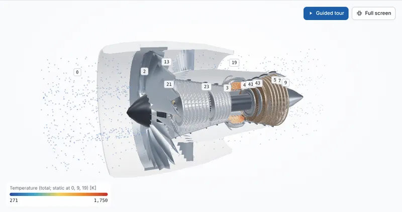
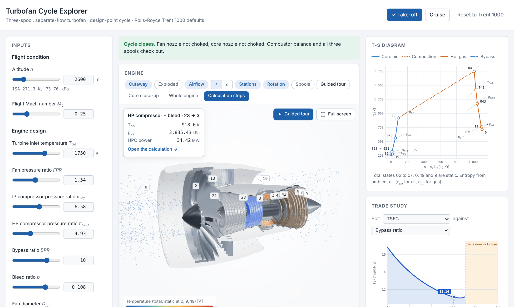
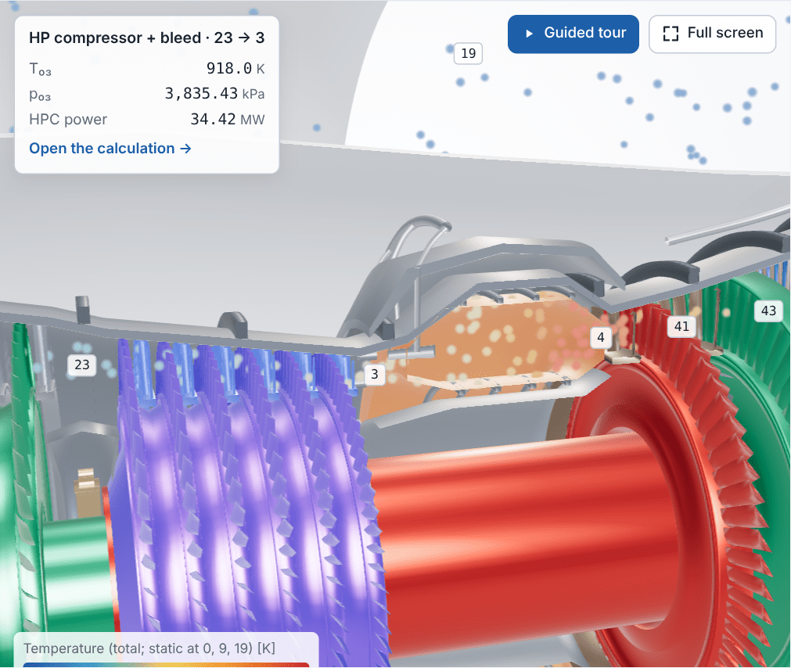
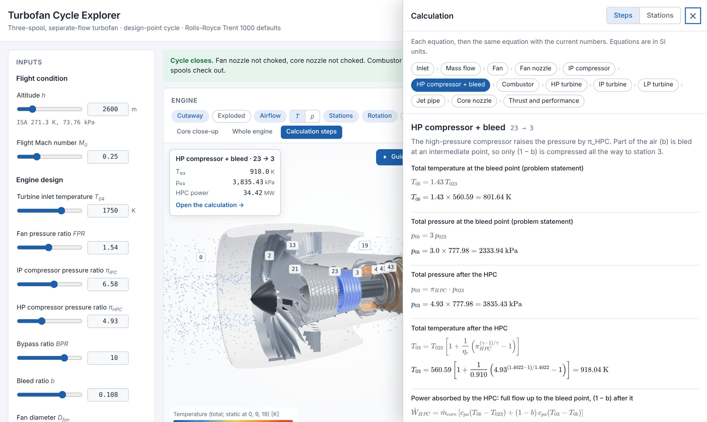
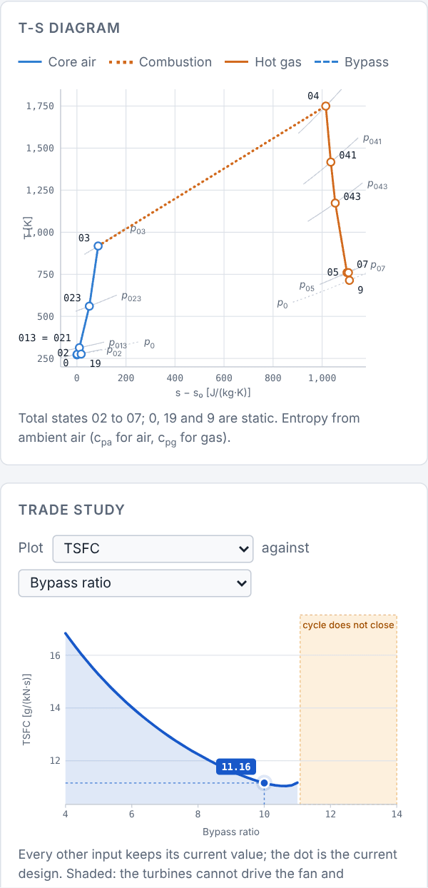

# Turbofan Cycle Explorer

An interactive, in-browser thermodynamic analysis of a **three-spool, separate-flow turbofan** at its design point, with Rolls-Royce Trent 1000 data as the defaults.

Change an input and the whole cycle is solved again at once. The 3D cutaway shows how the air's temperature and pressure change from the intake to the nozzles, and every number has its full calculation (equation, substituted values, result) one click away.

**Live demo:** coming soon

<p align="center">
  
</p>

## Motivation

As a mechanical engineer, I remember a course from university, Thermal Machines, one of the best courses I took, especially when the topic was aircraft. For me, this field is one of the best parts of being a mechanical engineer, and that is why I want to share the results. This project consists of the whole analysis of a turbofan (specifically the RR Trent 1000). In this part, you can see a 3D representation with the principal parts of the turbofan (fan, compressor, combustor, turbine and nozzle). Also, the idea is that you can change the values and look at how the results are affected. You can even see different graphs, depending on the analysis that you can do, for example, what the behavior of the specific thrust is when the altitude is increasing.

---

## What it does

<p align="center">
  
</p>

### 3D engine
- **Sectioned cutaway** of the static structure, with the rotors left whole so you can see the fan, the 8-stage IP compressor, the 6-stage HP compressor, the annular combustor and the HP, IP and LP turbines.
- **Airflow particles** coloured by total temperature or total pressure, computed from the current cycle.
- **Spool colouring and rotation.** The LP, IP and HP spools turn at the Trent 1000's real speed ratio, slowed 750× so you can follow them.
- **Exploded view**, station labels (0 → 9 / 19), core close-up and full-screen mode.
- **Guided tour**: the camera follows the air through 11 stops. Each stop explains what that component does, using the numbers for the inputs you set.
- Click any part to see its key values, then open the calculation behind them.

<p align="center">
  
</p>

### The maths, step by step
A side drawer lists every calculation by component. Each step shows the equation, the values substituted into it and the result, rendered with KaTeX. A second tab shows all station properties (T₀, p₀, T, p, C, M).

<p align="center">
  
</p>

### Diagrams and trade studies
- **T-s diagram** of the core and bypass streams, with the total-pressure isobars at each station.
- **Trade study**: sweep one input (BPR, TiT, FPR, π<sub>IPC</sub>, π<sub>HPC</sub>, bleed, altitude or Mach) and plot TSFC, net thrust, specific thrust, η₀, η<sub>th</sub> or η<sub>p</sub>. Points where the cycle cannot close are shaded as an infeasible region instead of being plotted.
- **Results**: net thrust split into its fan, core and pressure-thrust parts, mass flows, fuel flow, OPR, TSFC, specific thrust, spool powers and overall efficiency split into **η₀ = η<sub>th</sub> × η<sub>p</sub>**.
- **Take-off** and **Cruise** presets; the active one is highlighted. All values are in SI units. The app state is kept in the URL, so a link brings back the same case.

<p align="center">
  
</p>

---

## Engine model

| | |
|---|---|
| Configuration | Three spools: LP (fan + LPT), IP (IPC + IPT + 500 kW electrical offtake), HP (HPC + HPT). Separate bypass and core exhausts. |
| Station numbering | El-Sayed (2017): 0, 02, 013, 19 (bypass); 021, 023, 03, 04, 041, 043, 05, 07, 9 (core). |
| Atmosphere | International Standard Atmosphere (troposphere and tropopause). |
| Gas properties | Two constant specific heats: c<sub>pa</sub> for air (fitted to real-gas data at ambient temperature) and c<sub>pg</sub> = 1148 J/(kg·K) for the combustion gas. |
| Mass flow | From the fan diameter, with the fan-face Mach number fixed at 0.7. |
| Components | Isentropic efficiencies for intake, fan, compressors, turbines and nozzles; pressure losses in the combustor and jet pipe; mechanical efficiency on every shaft. |
| Bleed | Cooling bleed *b* is an input. It is taken from the HP compressor (p₀ = 3·p₀₂₃, T₀ = 1.43·T₀₂₃) and lost overboard. |
| Combustor | Fuel-air ratio from the energy balance, with combustion efficiency and the fuel's lower heating value. |
| Nozzles | Convergent. Each is checked for choking; a choked nozzle gives pressure thrust. |
| Efficiencies | η<sub>th</sub> from the jet kinetic power gain over the fuel power, η<sub>p</sub> from thrust power over the jet kinetic power gain. For a choked nozzle the fully-expanded equivalent velocity is used. |
| Feasibility | If the turbines cannot supply the compressor work, or the core nozzle has no pressure left to expand, the cycle is flagged as **not closing** and the reason is shown. |

---

## Running it locally

No dependencies to install, only [Node.js](https://nodejs.org/) 18 or later.

```bash
npm start   # http://localhost:8080
npm test    # runs the unit tests
```

## Project structure

```
index.html            page layout
css/styles.css        styles, light and dark themes
js/
  engine.js           cycle solver: stations, results and recorded calculation steps
  atmosphere.js       ISA atmosphere and air properties
  units.js            SI display units and number formatting
  equations.js        LaTeX templates for every calculation step
  mathPanel.js        calculation drawer
  tsDiagram.js        T-s diagram (SVG)
  sweep.js            trade-study sweeps and chart
  engineModel.js      procedural 3D engine geometry (Three.js)
  engineView.js       3D scene: cutaway, airflow, rotation, selection, camera
  tour.js             guided tour stops
  app.js              inputs, state and wiring
tests/                Node test runner suites
vendor/               Three.js and KaTeX (bundled, MIT licence)
docs/                 screenshots for this README
serve.mjs             minimal static server
```

## Limitations

- Design point only. There is no off-design or component-map matching.
- Constant specific heats for air and gas (no variable c<sub>p</sub> with temperature).
- The 3D geometry is a stylised model for teaching, not manufacturer data. Stage counts follow the Trent 1000, but blade shapes and proportions are approximate.
- Particle speeds in the airflow view are illustrative. The core stream is shown with more particles than its share of the mass flow so it can be seen.

## Credits

- Station numbering and cycle method: A. F. El-Sayed, *Aircraft Propulsion and Gas Turbine Engines*, 2nd ed., CRC Press, 2017.
- Engine data: university gas-turbine course problem based on the Rolls-Royce Trent 1000. Shaft speeds from public type-certificate data.
- [Three.js](https://threejs.org/) and [KaTeX](https://katex.org/), both MIT licence.

This is an independent educational project. It is not affiliated with or endorsed by Rolls-Royce.

## Author

**Luis Arango López**: [GitHub](https://github.com/LuisArango6) · [LinkedIn](https://www.linkedin.com/in/luis-arango-lopez)

## License

[MIT](LICENSE) © 2026 Luis Arango López
